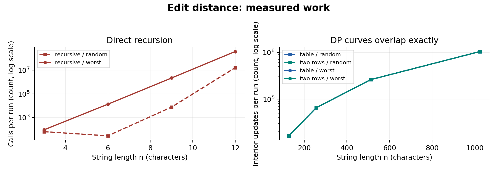
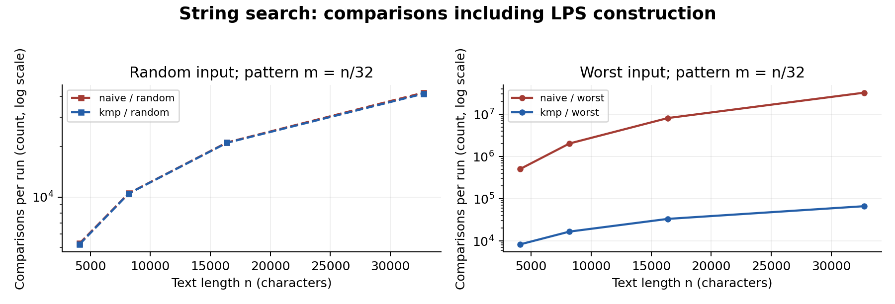
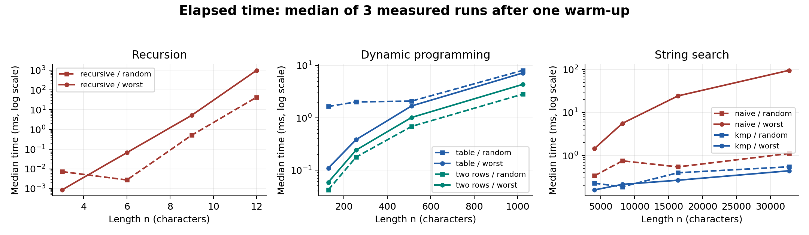

# Assignment 4 - City Search & Spell-Check

## Experiment Design Card

| Field | Design recorded before the first run |
|---|---|
| Question | Edit: how do recursive calls and DP cell updates grow? Search: how much repeated work does KMP avoid on a late mismatch? |
| Sizes | Recursive: n=m=3,6,9,12 (4x range; exponential growth limits sizes). Table and two rows: n=m=128,256,512,1024 (8x range). Search: text n=4096,8192,16384,32768; pattern m=n/32 (8x range). |
| Inputs | Edit random: two fixed-seed strings over ABCD, showing typical character matches; edit worst: A repeated n times vs B repeated n times, forcing all recursive branches. Search random: independent ABCD text/pattern; search worst: text A^n and pattern A^(m-1)B, forcing late mismatches at every naive start. |
| Metrics | Edit counts recursive calls including base calls, or interior DP cell updates (different work units, explicitly labeled). Search counts character comparisons including KMP LPS construction. Record each of 3 timed runs in milliseconds with nanoTime, after one unrecorded warm-up per case; use medians in plots. |
| Prediction | Recursive worst-case work grows exponentially; both DP versions update n*m cells and doubling n quadruples work. Two rows reduces stored DP integers from (n+1)(m+1) to 2(m+1). Naive worst-case comparisons grow quadratically because m grows with n; KMP grows linearly in n+m. Random searches should be close to linear. |
| Plots | 1. Edit work vs length, logarithmic y-axis, with separate panels for recursion and DP. 2. Search comparisons vs text length, logarithmic y-axis, random and worst panels. 3. Median time vs length (ms, logarithmic y-axis), separate recursive, DP and search panels. |
| Reproducibility | Seed 20261108; a fresh seed derived from family, input type and n for each case. Inputs, results and counters repeat exactly; wall-clock times inevitably vary. Timing includes counters and result allocation, excludes input generation, CSV writing and correctness checks. |

## Plots and results

Worst-case recursion explodes, while both DP variants have identical cell counts and quadruple their work when length doubles.

With m=n/32, an eightfold increase in text length raises worst-case Naive work about 64-fold but KMP work about eightfold.

Worst-case recursion and Naive search grow sharply; small random-input timings are noisy and need the counter plots for context.

## Prediction vs result

**Edit Distance.** The predicted growth is confirmed by the counters: worst-case recursion rises from 94 calls at n=3 to 377,393,953 at n=12. Both DP variants increase from 16,384 to 1,048,576 cell updates as n grows from 128 to 1024, exactly 64-fold. Random recursion is not monotonic: the chosen n=6 pair needs only 29 calls, versus 65 at n=3, because more matching suffix characters bypass branching. Thus one seeded random pair per size is illustrative, not a statistical average over all possible inputs.

**String search.** Worst-case Naive comparisons rise from 508,032 to 32,506,880, while KMP rises from 8,318 to 66,558; this supports the predicted quadratic versus linear growth along m=n/32. Both random-input counter curves are approximately linear and close together. All generated benchmark search cases have zero matches, isolating comparison costs; reference and random tests separately check successful and overlapping matches. No universal timing advantage is inferred from this sample.

## Measured time

Times are medians of three nanoTime measurements after one warm-up for each case, recorded with six decimal places in milliseconds. Worst-case recursion at n=12 took 992.561 ms; at text n=32768, worst-case Naive took 95.520 ms and KMP 0.443 ms. Small random-search timings do not increase smoothly. JIT compilation, garbage collection, allocation and shared-host scheduling can affect them; one warm-up is only a minimal control. Measurements include instrumentation and output-list allocation, but exclude input generation, validation and CSV writing. Counters give repeatable evidence of growth even when timings vary; repeatability means identical inputs, answers and counters, not identical elapsed times.

## Short answers

### Which input made search slowest, and why?

The measured Naive maximum was the worst-case pair at n=32768 and m=1024, taking 95.520 ms. The text contains only A, while the pattern ends in B after many A characters. Each valid naive start therefore compares the entire pattern before failing, producing (n-m+1)*m comparisons. KMP reuses the prefix information instead of restarting; this adversarial input is worst for Naive, not a claim that it always gives KMP the highest elapsed time.

### How large an n could recursive Edit Distance handle?

The largest tested length was n=m=12, and the worst case completed with 377,393,953 calls and a median of 992.561 ms. The experiment deliberately stopped at this planned size because repeated subproblems cause exponential growth. This was a practical experiment cutoff, not a measured absolute hardware limit or a program failure. Easy identical strings can be much longer because they follow a single diagonal path.

### What do two rows gain and lose?

Two rows retain only the previous and current DP rows, reducing auxiliary storage from O(n*m) to O(m). For n=m=1024, this means 2,050 stored integers rather than 1,050,625, excluding Java array headers. The answer and O(n*m) running time stay the same, but the complete table is discarded. Therefore this version cannot directly backtrack a sequence of edits without extra work or a different reconstruction algorithm.

### Which search would you choose for the city platform?

I would choose KMP for exact pattern searches in potentially long logs. Its O(n+m) bound protects the platform from repetitive texts that force Naive to repeat comparisons. The trade-off is an O(m) LPS array and more code than Naive, which can be sufficient for very small inputs. For misspelled street-name suggestions, I would use the two-row Edit Distance separately, since exact substring search does not correct typos.

## Validation

Validation: all 7 JUnit 5 test methods passed, including the provided reference values, edge cases, 100 random short-string edit comparisons and 100 random search comparisons. The CSV contains 120 measured rows; all three runs for each case have equal counters and results. A second complete execution also reproduced all non-time CSV fields. Environment: Linux x86_64, Microsoft OpenJDK 21.0.13, Maven 3.9.9; Java sources target release 17. The original pre-run card is preserved in EXPERIMENT_PLAN.md; no design changes were made.
